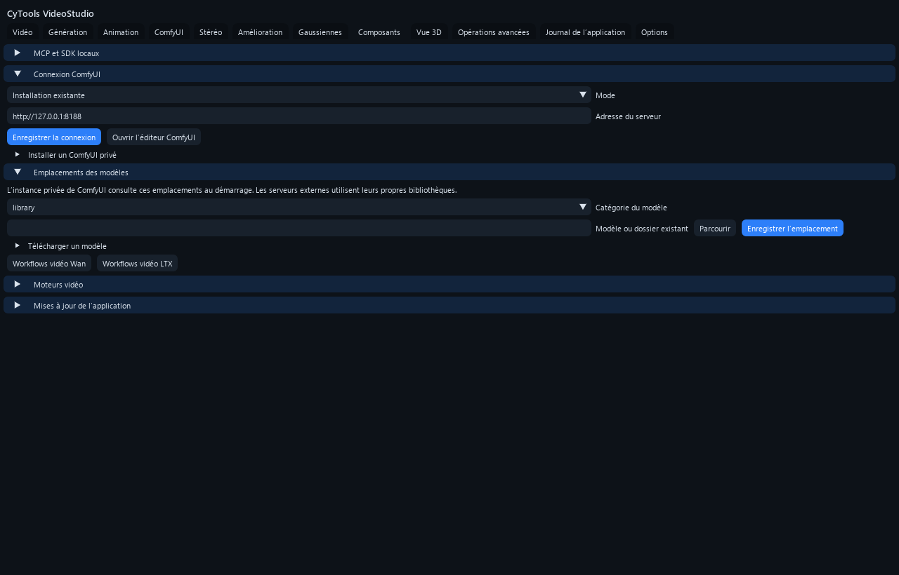

<table width="100%">
  <tr>
    <td width="300" align="left" valign="top">
      <a href="LISEZ-MOI.md">Guide de démarrage</a> 
      <a href="app/Validation.md">Validation</a> 
      <a href="README.md">English</a>
    </td>
    <td width="400" align="center" valign="middle"></td>
    <td width="300" align="right" valign="top">
      <a href="LICENSE"><strong>AGPL-3.0-only</strong></a> 
      <strong>0.1.1 · En développement</strong> 
      Windows x64 testé
    </td>
  </tr>
</table>

# CyTools VideoStudio

VideoStudio regroupe le traitement vidéo, la génération IA, la stéréo 3D et les outils de scènes gaussiennes dans une interface CyUI. CyToolsCore expose les mêmes opérations dans l’application, le CLI, le SDK et le MCP.

## Ce que tu peux faire

- **Vidéo et animation.** Inspecter et découper une vidéo, comparer des images, redimensionner un flux mono ou stéréo, encoder en H.264, HEVC ou ProRes et animer une image fixe avec panoramique, zoom et interpolation.
- **ComfyUI et modèles.** Exécuter des workflows API sur une instance locale existante, un serveur réseau ou une instance privée. L’éditeur ComfyUI sert à créer les graphes et ComfyFlow à importer les graphes et les bundles. Les modèles et bibliothèques déjà présents peuvent être référencés par leur chemin. Les poids peuvent aussi être téléchargés à la demande.
- **Stéréo et amélioration.** Raccorder VideoToStereo3D et CyVR. Les essais Windows couvrent la conversion stéréo CUDA, RTX Video Super Resolution et DLSS Super Resolution.
- **Génération et scènes gaussiennes.** Les adaptateurs MiniMax H3 et VideoToGaussian exposent leurs réglages et utilisent les installations compatibles. Les essais couvrent l’extraction d’image, l’analyse vidéo et l’aperçu 3D interactif. La génération H3 complète, la reconstruction gaussienne et DLSS 5 NR restent à valider de bout en bout. Voir le [détail des opérations et des essais](app/README.md#operations-and-validation).

---

## Installation

Depuis un paquet Windows décompressé, installe Python 3.11 x64, lance `./app/install.ps1`, puis ouvre **CyTools_VideoStudio.exe**. Depuis les sources Git, indique le wheel CyToolsCore 0.12.0 compilé pour ta plateforme.

~~~powershell
.\app\install.ps1 -CoreWheel 'C:\chemin\vers\cytools_core-0.12.0-py3-none-win_amd64.whl'
~~~

Dans **Options**, sélectionne **Français**. Ouvre **Composants** pour pointer vers FFmpeg, les moteurs vidéo et les dossiers de modèles, puis choisir une connexion ComfyUI. Les poids, CUDA, PyTorch et les moteurs optionnels s’installent à la demande. Les scripts Linux sont disponibles pour les essais. Voir le [guide de démarrage](LISEZ-MOI.md).

## Utilisation par une IA

Dans **Composants → MCP et SDK locaux**, démarre le serveur puis copie l’adresse MCP affichée dans ton client. Le guide technique couvre MCP stdio, les commandes CLI, les entrées locales et l’export des résultats. Voir le [guide CLI et MCP](app/README.md#sdk-cli-and-mcp).

---

## Licence

Copyright © 2026 Cyberalien. VideoStudio utilise la [GNU Affero General Public License v3.0](LICENSE). CyUI, CyToolsCore et CyMCPSDK sont accompagnés de leurs notices MIT. Les moteurs associés et les poids ont leurs propres conditions. Voir les [licences des composants](LICENCES) et [l’inventaire des licences](app/licenses.json).
