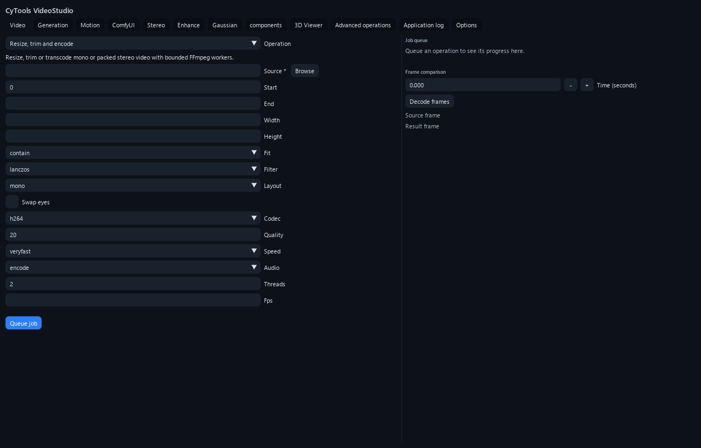

<table width="100%">
  <tr>
    <td width="300" align="left" valign="top">
      <a href="app/README.md">Technical guide</a> 
      <a href="app/Validation.md">Validation</a> 
      <a href="README.fr.md">Français</a>
    </td>
    <td width="400" align="center" valign="middle"></td>
    <td width="300" align="right" valign="top">
      <a href="LICENSE"><strong>AGPL-3.0-only</strong></a> 
      <strong>0.1.1 · In development</strong> 
      Windows x64 tested
    </td>
  </tr>
</table>

# CyTools VideoStudio

VideoStudio brings video processing, AI generation workflows, stereo 3D and Gaussian scene tools into a CyUI desktop application. CyToolsCore exposes the same video operations to the desktop, CLI, SDK and MCP.

## What you can do

- **Video and motion.** Probe and trim video, compare frames, resize mono or packed stereo footage, encode to H.264, HEVC or ProRes, and animate a still image with pan, zoom and easing.
- **ComfyUI and models.** Run API workflows on an existing local, network or private ComfyUI instance. Use the ComfyUI editor to build graphs and ComfyFlow to import editor graphs and bundles. Register models or libraries already stored on disk, or download weights on demand.
- **Stereo and upscaling.** Bring your VideoToStereo3D and CyVR installations to the studio. Windows tests covered CUDA stereo conversion, RTX Video Super Resolution and DLSS Super Resolution.
- **Generation and Gaussian scenes.** The MiniMax H3 bridge and VideoToGaussian adapters expose task controls and accept compatible engine installations. The test passes covered frame extraction, video analysis and the interactive 3D preview. Full H3 generation, Gaussian reconstruction and DLSS 5 NR are still awaiting end-to-end validation. See the [operation and validation details](app/README.md#operations-and-validation).

---

## Installation

For an extracted Windows package, install Python 3.11 x64, run `./app/install.ps1`, then open **CyTools_VideoStudio.exe**. For the Git source checkout, supply the CyToolsCore 0.12.0 wheel built for your platform.

~~~powershell
.\app\install.ps1 -CoreWheel 'C:\path\to\cytools_core-0.12.0-py3-none-win_amd64.whl'
~~~

Use **Components** to locate FFmpeg and companion engines, select your ComfyUI connection and register model locations. Model weights, CUDA, PyTorch and the optional engines are installed on demand. The Linux setup and launcher scripts are available for testing. See [installation and platform details](app/README.md#installation).

## Use from an AI client

Open **Components → Local MCP and SDK** and start the local MCP server. Copy the displayed address into your client. The technical guide covers MCP stdio, CLI commands, file inputs and artifact export. See the [CLI and MCP guide](app/README.md#sdk-cli-and-mcp).

---

## License

Copyright © 2026 Cyberalien. VideoStudio uses the [GNU Affero General Public License v3.0](LICENSE). CyUI, CyToolsCore and CyMCPSDK ship with their own MIT notices. Linked engines and model weights have their own terms. See the [component licenses](LICENCES) and the [runtime license inventory](app/licenses.json).
